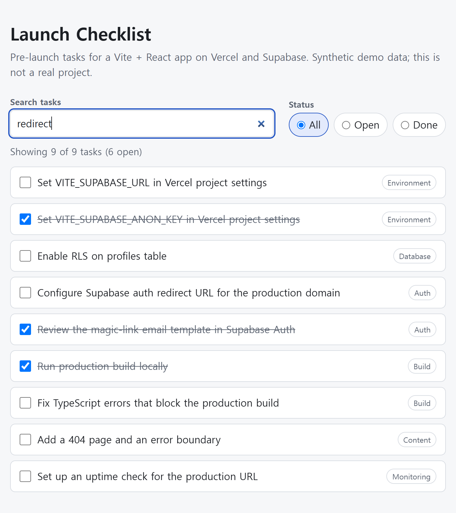
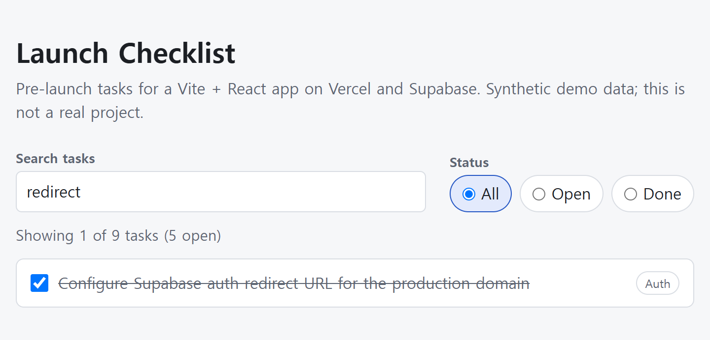
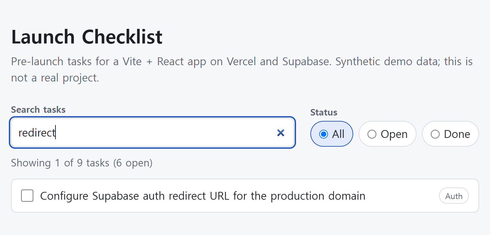

# Search and status filters silently ignored (stale derived state)

> **Self-created technical demo — not client work.** The bug in this repository was introduced on purpose to build a
> reproducible before/after example. It is not taken from anyone's codebase, and no
> client was involved. Everything below was measured in this repository by
> `npm run case:build` on 2026-10-20.

| | |
|---|---|
| Bug commit | `538d0e58552f7194d5025c1f9f5af517a1d83c1d` — Initial Launch Checklist app (tag `demo-bug`) |
| Fix commit | `0564847a26ac81ae9f98c1474b3a6cf968cc0f27` — Fix: search and status filters ignored (stale derived state) (tag `demo-fix`) |
| Regression test | `src/App.test.tsx` |
| Source files changed by the fix | `src/App.tsx` |
| Public repository | REPLACE_ME: public repo URL once the founder publishes the demo |

## Stack

- Vite 7.3.7
- React 19.3.1
- TypeScript 5.9.3
- Vitest 3.2.7
- Testing Library (React) 16.3.3
- ESLint 9.39.5 with eslint-plugin-react-hooks 5.2.0

## Summary

In a small React checklist app, the search box and the status filter looked broken: typing or picking a status changed nothing on screen. The filtered list was kept in its own useState and refreshed by a useEffect that only watched the task array, so it never re-ran when the query or the status changed.

## What the user saw

You type "redirect" into the search box and all nine tasks stay on screen; you click the "Open" filter and the done tasks stay too. The summary line still says "Showing 9 of 9 tasks". As soon as you tick any checkbox, the list suddenly applies the filters you chose earlier, which makes the bug look intermittent and hard to describe.

## How to reproduce

1. Check out the bug commit: git checkout demo-bug (then npm install if you have not already).
2. Start the app: npm run dev, and open the printed localhost URL in a browser.
3. Type "redirect" in the "Search tasks" box. Expected: only "Configure Supabase auth redirect URL for the production domain" remains. Actual: all 9 tasks stay visible and the summary still reads "Showing 9 of 9 tasks (6 open)".
4. Click the "Open" status chip. Expected: the 3 done tasks disappear. Actual: nothing changes.
5. Tick any task checkbox. Actual: the list now suddenly applies both filters, because toggling changes the task array, which is the only thing the effect watches.
6. Optional: run npm run lint on this commit. ESLint reports react-hooks/exhaustive-deps on the useEffect in src/App.tsx, naming the missing "query" and "status" dependencies.
7. Return to the fixed code with git checkout main and repeat steps 2 to 4: filtering now happens as you type and as you click.

## Root cause

src/App.tsx stored the filtered list as separate state, const [visible, setVisible] = useState<Task[]>(tasks), and synchronised it with useEffect(() => { setVisible(filterTasks(tasks, query, status)) }, [tasks]). The dependency array lists only tasks, so React re-runs the effect when a task is toggled but not when query or status change. The inputs themselves render correctly because they have their own state, so the UI looks responsive while the list silently shows stale data. The react-hooks/exhaustive-deps lint rule flagged exactly this line in the first commit, but a warning is easy to scroll past.

## The fix

Replace the state-plus-effect pair with a derived value: const visible = useMemo(() => filterTasks(tasks, query, status), [tasks, query, status]). The filtered list is now computed during render from its three inputs, so there is no second copy of the data that can fall out of sync and no extra render pass after each change. The commit also adds a regression test (src/App.test.tsx) that drives the real UI with Testing Library: it types into the search box and selects the Open filter, then asserts on the rendered titles. Unit tests for the pure filterTasks helper (src/lib/filterTasks.test.ts) pin down the matching rules.

Diff between `demo-bug` and `demo-fix` (`src/` only, test files excluded):

```diff
diff --git a/src/App.tsx b/src/App.tsx
index e896931..dc031b9 100644
--- a/src/App.tsx
+++ b/src/App.tsx
@@ -1,4 +1,4 @@
-import { useEffect, useState } from 'react'
+import { useMemo, useState } from 'react'
 import { SearchBox } from './components/SearchBox'
 import { StatusFilter } from './components/StatusFilter'
 import { Summary } from './components/Summary'
@@ -12,11 +12,12 @@ export default function App() {
   const [query, setQuery] = useState('')
   const [status, setStatus] = useState<StatusFilterValue>('all')
 
-  const [visible, setVisible] = useState<Task[]>(tasks)
-
-  useEffect(() => {
-    setVisible(filterTasks(tasks, query, status))
-  }, [tasks])
+  // Derived data: computed from the current inputs on every relevant change,
+  // instead of being copied into its own state and synced with an effect.
+  const visible = useMemo(
+    () => filterTasks(tasks, query, status),
+    [tasks, query, status],
+  )
 
   function toggleTask(id: string) {
     setTasks((previous) =>
```

## Proof: the regression test fails before and passes after

`npm run prove` (scripts/prove-regression.mjs) temporarily writes the `demo-bug`
version of `src/App.tsx` into the working tree, runs the test suite from HEAD against
it, restores the file, and runs the suite again. It exits 0 only when the first run fails
and the second passes, judged from Vitest's own report (failed tests counted, test files that
failed to load rejected), not from the exit code alone. Local paths are shown as `<repo>`;
timings are replaced by `<time>`, `<elapsed>` and `<n>ms` so reruns are reproducible; long
output is trimmed where marked.

### Before: tests run against the `demo-bug` source

```text
 RUN  v3.2.7 <repo>

 ✓ src/lib/filterTasks.test.ts (7 tests) <n>ms
 ❯ src/App.test.tsx (5 tests | 3 failed) <n>ms
   ✓ Launch Checklist filters > shows every seeded task before any filter is applied <n>ms
   × Launch Checklist filters > filters the list as you type in the search box <n>ms
     → expected [ …(9) ] to deeply equal [ Array(1) ]
   × Launch Checklist filters > hides done tasks when the Open status filter is selected <n>ms
     → expected [ …(9) ] to not include 'Set VITE_SUPABASE_ANON_KEY in Vercel …'
   × Launch Checklist filters > combines the search query with the status filter <n>ms
     → expected [ …(9) ] to deeply equal [ …(2) ]
   ✓ Launch Checklist filters > toggling a task updates the open count <n>ms

 Test Files  1 failed | 1 passed (2)
      Tests  3 failed | 9 passed (12)
   Start at  <time>
   Duration  <elapsed>

⎯⎯⎯⎯⎯⎯⎯ Failed Tests 3 ⎯⎯⎯⎯⎯⎯⎯

 FAIL  src/App.test.tsx > Launch Checklist filters > filters the list as you type in the search box
AssertionError: expected [ …(9) ] to deeply equal [ Array(1) ]

- Expected
+ Received

  [
+   "Set VITE_SUPABASE_URL in Vercel project settings",
+   "Set VITE_SUPABASE_ANON_KEY in Vercel project settings",
+   "Enable RLS on profiles table",
    "Configure Supabase auth redirect URL for the production domain",
+   "Review the magic-link email template in Supabase Auth",
+   "Run production build locally",
+   "Fix TypeScript errors that block the production build",
+   "Add a 404 page and an error boundary",
+   "Set up an uptime check for the production URL",
  ]

 ❯ src/App.test.tsx:28:29
     26|     await user.type(screen.getByRole('searchbox', { name: /search task…
     27|
     28|     expect(visibleTitles()).toEqual([
       |                             ^
     29|       'Configure Supabase auth redirect URL for the production domain',
     30|     ])

⎯⎯⎯⎯⎯⎯⎯⎯⎯⎯⎯⎯⎯⎯⎯⎯⎯⎯⎯⎯⎯⎯⎯⎯[1/3]⎯
… [40 more lines trimmed: details of the remaining failing tests] …
```

### After: tests run on `demo-fix`

```text
 RUN  v3.2.7 <repo>

 ✓ src/lib/filterTasks.test.ts (7 tests) <n>ms
 ✓ src/App.test.tsx (5 tests) <n>ms

 Test Files  2 passed (2)
      Tests  12 passed (12)
   Start at  <time>
   Duration  <elapsed>
```

### The warning that was already there

ESLint output for the `demo-bug` version of the changed file (rule `react-hooks/exhaustive-deps`,
configured at its default level, "warn"):

```text
<repo>\src\App.tsx
  19:6  warning  React Hook useEffect has missing dependencies: 'query' and 'status'. Either include them or remove the dependency array. You can also replace multiple useState variables with useReducer if 'setVisible' needs the current value of 'query'  react-hooks/exhaustive-deps

✖ 1 problem (0 errors, 1 warning)
```

## Lesson

If a value can be computed from props or state, compute it during render (a plain expression or useMemo) instead of copying it into state and syncing it with an effect. Treat react-hooks/exhaustive-deps warnings as bugs until proven otherwise, and cover the user-visible behaviour with a test that fails before the fix.

## Screenshots

Captured by `npm run case:screenshots` (scripts/capture-screenshots.mjs) on 2026-10-20 with Chrome/155.0.8059.40
running headless, viewport 1024x900 CSS px at 2x, light colour scheme. The script writes the `demo-bug`
version of the changed source file into the working tree the same way the proof does, drives this repo's dev
server over the Chrome DevTools protocol, clicks the search box and types "redirect" key by key, reads the
summary line and the task rows back from the DOM, and refuses to capture when they differ from what is
described here. It then restores the file and repeats the typing on the fixed code. Each "Page state" line
quotes what it read at the moment of the capture. The images are unedited captures of the app area
(`main.app`) in this repository, not mock-ups.

### Before the fix: "redirect" typed, nothing filtered



Before the fix. "redirect" has been typed into the search box, yet all 9 tasks are still listed and the summary still says 9 of 9.

Page state read by the script: summary "Showing 9 of 9 tasks (6 open)", 9 task rows; source: `demo-bug` (`538d0e5`).

### Before the fix: one checkbox ticked, the stale filter suddenly applies



Still before the fix. Ticking one checkbox changes the task array, the effect finally re-runs, and the list suddenly applies the search typed earlier. This is what made the bug look intermittent.

Page state read by the script: summary "Showing 1 of 9 tasks (5 open)", 1 task row; source: `demo-bug` (`538d0e5`).

### After the fix: the same keystrokes filter as you type



After the fix. The same keystrokes narrow the list as you type: 1 of 9 tasks shown, no checkbox touched.

Page state read by the script: summary "Showing 1 of 9 tasks (6 open)", 1 task row; source: `HEAD` at capture time (`f08d6c9`), whose non-test `src/` is identical to `demo-fix`.

## Commits

- `538d0e58552f7194d5025c1f9f5af517a1d83c1d` Initial Launch Checklist app
- `0564847a26ac81ae9f98c1474b3a6cf968cc0f27` Fix: search and status filters ignored (stale derived state)

Note for the publisher: rewriting authorship before publishing (see README) changes these hashes;
rerun `npm run case:screenshots` and `npm run case:build` afterwards so this file, `case.json` and the
screenshots' manifest match the published history.
